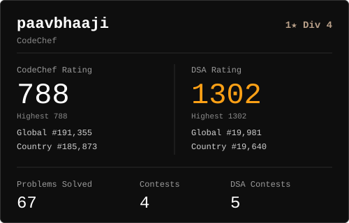
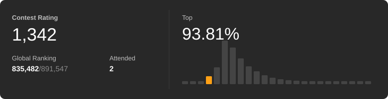

## Hi, I'm Shruti 👋

- 🎓 B.Tech student at **Galgotias University**
- 💻 Building full-stack projects with **Next.js** and **Supabase**
- 🌱 Currently solving **DSA** in **C++** 

  
  
  
  
  
  

## Tech Stack

  

## 📈 Coding Progress

<table align="center">
  <tr>
    <td align="center" width="50%">
      
    </td>
    <td align="center" width="50%">
      
    </td>
  </tr>
</table>

  

